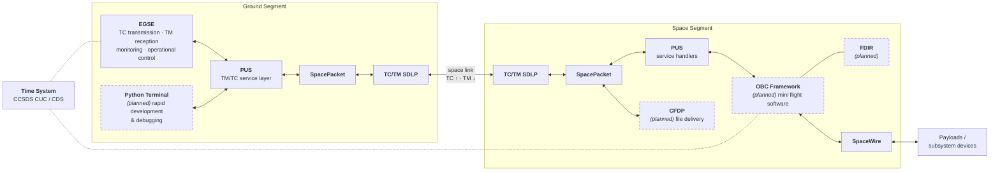

# OpenSpaceCode

OpenSpaceCode is an engineering-focused colaborative initiative for developing reusable software components and reference implementations for small-scale (academic) space applications.

Our objective is to deliver reliable, standards-aligned building blocks that can be adopted by students, student organizations, and technical teams for educational purposes and mission development activities.

## Scope

- Implement practical software aligned with CCSDS and ECSS standards
- Provide understandable, extensible baseline solutions for mission-specific adaptation
- Support education-oriented use with engineering-grade quality expectations

## Released libraries

- CCSDS SpacePacket protocol implementation in C
- CCSDS SpaceWire protocol implementation in C
- CCSDS TC/TM SDLP protocol implementation in C
- ECSS-E-ST-70-41C Telemetry and Telecommand Packet Utilisation Standard (TM/TC PUS)
- Desktop EGSE (Electrical Ground Support Equipment) for TC transmission, TM reception, monitoring, and operational control on ground
- Time system (CCSDS CUC / CDS time)

## Planned / in progress

- CCSDS File Delivery Protocol (CFDP)
- Python terminal with CCSDS protocols support for rapid development & debugging
- OBC framework (mini flight software)
- FDIR (Fault Detection, Isolation and Recovery)

## Contribution

Contributions are welcome, including new standard implementations, functional extensions, validation improvements, and documentation enhancements.

The project prioritizes correctness, clarity, maintainability, and practical usability in mission-oriented contexts.

## Architecture Diagram

